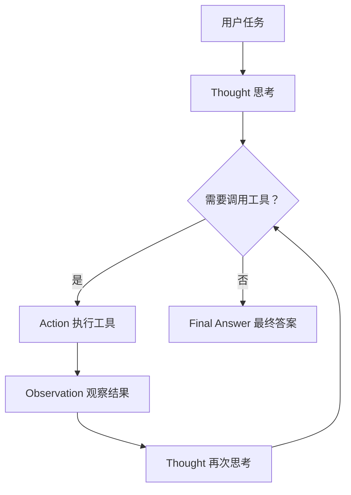
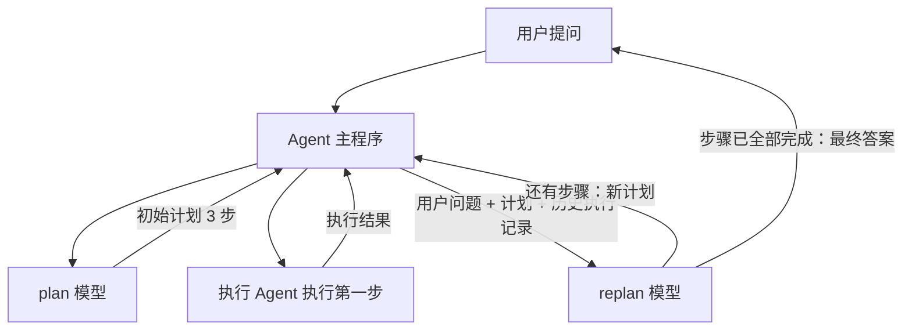

  <button style="padding:8px 20px; background:var(--theme-color); color:#fff; border:none; border-radius:8px; cursor:pointer; font-size:14px;">Agent 工作模式</button>
  

## 典型的 Agent

**ex.1 Cursor** — 一个用于编程的 Agent，我们只需要给它提交任务，它便会调用大模型和各种工具来帮我们写代码，直至完成任务。

**ex.2 Manus** — 举一个例子：用户希望 Manus 帮他比较几个手机的性能、照相等能力。为了解决用户的问题，Manus 会生成执行计划，搜索并浏览相关网页，最后把报告整理成一个页面展示给用户看。整个过程基本上也不需要用户插手，Manus 利用大模型和一些工具就可以解决掉用户的问题。

## Agent 的运行模式之一 — ReAct 模式（Thought / Action / Observation / Final Answer）

全称是 **reasoning and acting**，也就是思考与行动。ReAct 可能是目前使用最为广泛的 Agent 运行模式。如果要理解学习 Agent 的实现原理，**绕不开 ReAct**。

### ReAct 模式的运行流程

在 ReAct 模式下，用户先提交任务，然后 Agent 先做思考（**thought**）。它思考后会决定是否调用工具。

如果需要，它便去调用合适的工具，比如读取文件、写入文件内容之类的，ReAct 称这一步是 **action**。

在行动后，Agent 会去查看工具的执行结果——比如所读取的文件内容、写入是否成功等等——ReAct 称这一步是 **observation**，也就是观察工具执行结果。

在观察之后，ReAct 会继续思考，再次判断是否需要调用工具。如果还是需要，就继续重复之前的「行动 → 观察 → 思考」流程。

直到某个时刻它认为不需要再调用工具了，可以直接给出结论，此时就输出了 **final answer**，整个流程到此结束。

所以从这个流程也可以看出，**ReAct 流程的核心步骤是 thought、action、observation 和 final answer**。

### ReAct 模式到底是怎么「实现」的 — 主要靠系统提示词，和模型训练关系不大

#### 核心观点

先来看一个问题：模型拿到问题后为什么先想再动，而不是直接动手？

因为这不是训练出来的，是**提示词规定**的。系统提示词是和用户问题一起送进模型的，它规定了三件事：**角色、运行时要遵守的规则、环境信息**。

一个最小例子：系统提示词里写「你的回答必须包含两个 XML 标签，一个 `<question>` 放用户问题，一个 `<answer>` 放你的回答」。把这段提示词和问题一起发过去，模型就照着这个格式输出了。格式约束完全来自提示词，而非模型能力。

#### ReAct 版系统提示词的结构 — 五个部分

| 部分          | 作用       | 具体内容                                                                                                                                     |
| ------------- | ---------- | -------------------------------------------------------------------------------------------------------------------------------------------- |
| ① 职责 / 描述 | 定义行为模式 | 「你需要解决一个任务，为此将任务分解为多个步骤；每个步骤先用 thought 思考要做什么，再用 action 调用工具；工具结果通过 observation 返回；持续这个循环，直到信息足够给出 final answer」 |
| ② 示例        | few-shot   | 例 1：艾菲尔铁塔有多高 → thought → action → observation → 最终答案。 例 2：同样流程但调用两次工具。                                         |
| ③ 可用工具    | 工具清单   | 读文件、写文件、执行终端命令（三个最常用的）。                                                                                               |
| ④ 注意事项    | 限制与规范 | 明确告知模型行为限制。                                                                                                                       |
| ⑤ 环境信息    | 补充上下文 | 当前操作系统、目录路径、目录下的文件列表。                                                                                                   |

关键点：① 那段「职责描述」其实就是把 ReAct 执行流程图用自然语言写了一遍——讲者自己的说法是：「这段话其实就是在描述我们刚才那个 ReAct 执行流程图，我们希望大模型按照 ReAct 这个标准来运作。」

#### 三个要点

1. **示例是格式的主要依据。** 五个部分里，示例承担最关键的作用：光有 ① 的规则，模型不一定会写对标签结构；给出两三个完整的输入输出范例后，模型才会照着做。这与 few-shot prompting 的机制相同。
2. **环境信息让模型掌握它不知道的信息。** 操作系统类型、当前目录、文件列表这些内容，模型本身不可能知道（尤其在没有工具调用前），只能由提示词提供。这是 Agent 能实际操作文件系统的前提。
3. **整个 ReAct 循环的本质就是一段「格式约定 + 范本」。** thought / action / observation / final answer 这套标签，是人为约定的文本协议——模型输出这样格式的文字，外面的程序解析出 action、真正执行工具、再把结果填进 observation 塞回去。提示词只负责让模型说出这些内容和格式，理解并执行这些内容则由程序负责。

#### 总结

**ReAct 是系统提示词定义出来的工作规范，并非模型内置的能力。** 提示词通过职责描述（规定循环规则）、示例（提供模板）、工具清单（说明可调用工具）、注意事项（设置限制）和环境信息（补充上下文），让模型按 thought → action → observation 循环输出；模型本身还是那个模型，只是被这套规则限定了行为方式。

## 另一种构建模式：Plan and Execute — 核心特征是「先出计划 → 边执行边改计划」

### 一句话概括

ReAct 是「想一步、做一步」；Plan and Execute 是「先排好全部步骤，再逐步执行，且每执行一步就回头改计划」。后者由 **plan 模型、replan 模型、执行 Agent 和主程序** 四个模块组成，靠动态重规划获得灵活性。

### 为什么会有这个模式

ReAct 是最常见、最广泛使用的模式，但不是唯一方案。

很多 Agent 的实际做法都是「先规划再执行」：Manus 回答前会先建一个待办列表，后续都按列表走；Claude Code 也经常先创建 todo 再执行。

这类模式目前没有统一名字，各家实现各有差异。这里讲的是其中比较有名的一种实现——LangChain 提出的 Plan and Execute。它同样先规划再执行，但引入了动态修改规划的环节，因此灵活性大大提高。

### 四个模块

| 模块         | 职责         | 说明                                                                      |
| ------------ | ------------ | ------------------------------------------------------------------------- |
| plan 模型    | 出初始执行计划 | 只负责拆解，不负责执行。                                                 |
| replan 模型  | 修改计划     | 可以和 plan 是同一个模型，也可以拆成两个；这里为了讲清楚暂列为两个。       |
| 执行 Agent   | 执行每一步   | Agent 套 Agent——外层 Agent 内部还有一个 Agent；它用什么模式、内置什么工具，外层完全不关心。 |
| Agent 主程序 | 串联整个流程 | 相当于编排器。                                                            |

> 这里有一个值得记住的设计思路：**执行层是黑盒**。Plan and Execute 只要求执行 Agent「能完成指定步骤」，不约束其内部实现——这就是它比 ReAct 更易替换组件的原因。

### 运行流程（以「今年澳网男子冠军的家乡是哪里？」为例）

**初始计划（由 plan 模型给出，共 3 步）：**

1. 查询**当前日期**
2. 查询**对应年份**的澳网男子冠军名字
3. 用这个名字查询**冠军的家乡**

然后主程序把计划交给执行 Agent 执行第一步。执行 Agent 内置网络搜索工具，可以搜到当前日期——这里特意说明：**执行 Agent 完全可以用别的模式运行，是不是 ReAct 无所谓。**

### 三轮循环的模拟

| 轮次 | 执行环节                          | replan 环节产出                                                                                        |
| ---- | --------------------------------- | ------------------------------------------------------------------------------------------------------ |
| 1    | 执行第 1 步「查当前日期」→ 得到 2025 | 生成第二个计划： ①~~查当前日期~~（已完成，删掉） ②查 2025 年澳网冠军名字（抽象步骤变具体） ③查家乡 |
| 2    | 执行新计划第 1 步「查 2025 年冠军」→ 得到名字 | 生成第三个计划：只剩「查该冠军的家乡」。                                                               |
| 3    | 执行最后一步 → 得到家乡           | 发现所有步骤已完成。                                                                                   |

### 易错点

之前说「主程序请求 replan 模型给出一个新计划」——这个说法**不准确**。

准确说法是：replan 模型有两个出口：要么**返回新的执行计划（还有步骤要做）**，要么**返回最终答案（已无步骤可做）**。第三轮里 replan 发现没有步骤了，它返回的不是计划，而是最终答案；主程序收到后直接转发给用户，流程结束。

### Plan and Execute 和 ReAct 的区别

|              | ReAct             | Plan and Execute                        |
| ------------ | ----------------- | --------------------------------------- |
| **规划粒度** | 每次只想**下一步**       | 一次性规划**全部步骤**                        |
| **计划可变性** | 隐含在 thought 里，天然灵活 | 显式计划 + **显式** replan，改动有据可查  |
| **结构**     | 单层循环            | **双层**：外层编排，内层执行（Agent 套 Agent） |

### 选用场景抉择

- **Plan and Execute**：更适合**步骤多、有依赖关系**的任务。因为计划是可见、可改的，你能知道它「现在做到第几步」，出错时也能定位到具体步骤重来。
- **ReAct**：适合**步骤少、需要临场应变**的任务。
