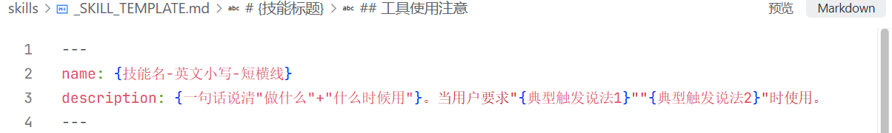
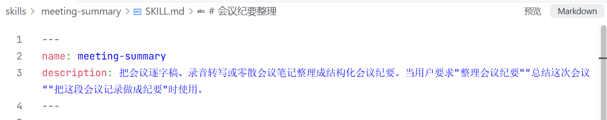
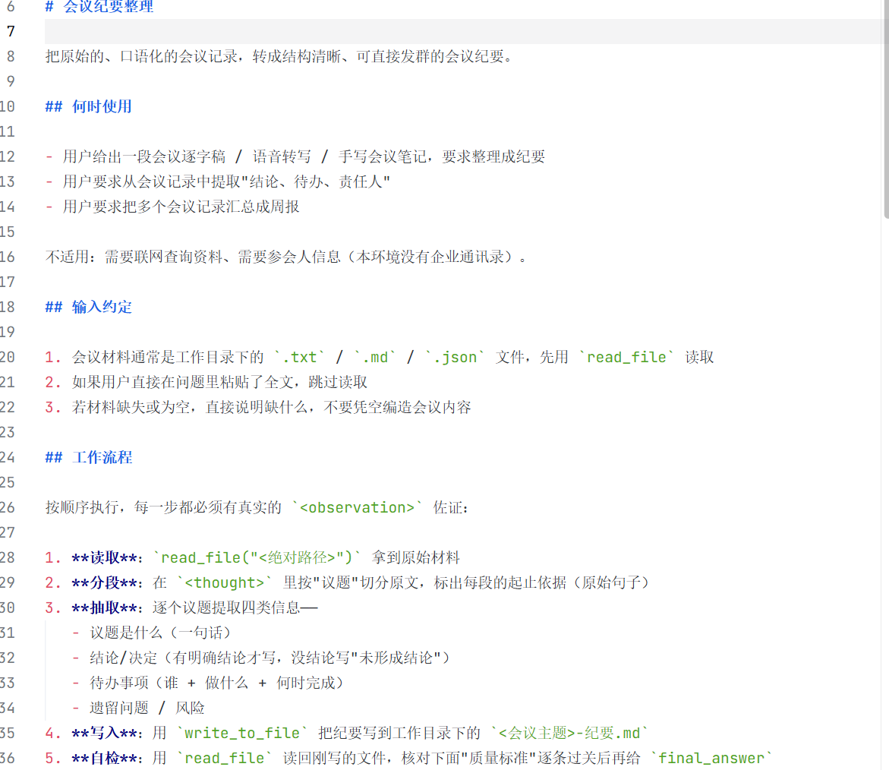
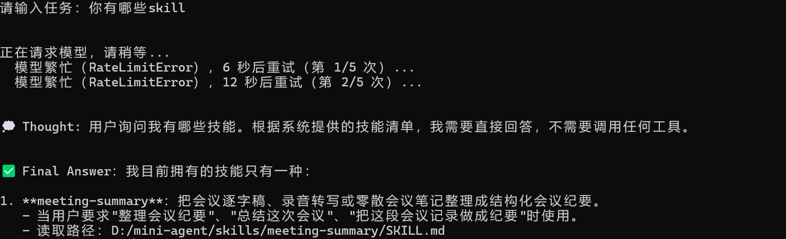

## Agent Skill 是什么？

通俗地讲，Agent Skill 其实就是一个大模型可以随时翻阅的说明文档。

例子：

- **智能客服 skill**：明确交代"遇到投诉得先安抚用户情绪，而且不得随意承诺"。
- **会议总结 skill**：必须按照「参会人员 / 议题 / 决定」这个格式输出总结内容。

## 基础用法：建一个"会议总结助手"

以 ReAct agent 为例，全程四步：

| 步骤       | 操作                                              |
| ---------- | ------------------------------------------------- |
| ① 进目录   | 进入用户目录下的 /skills 文件夹                    |
| ② 建文件夹 | mkdir 会议总结助手——文件夹名就代表 skill 的名字      |
| ③ 建文件   | 用 VS Code 打开该文件夹，新建 SKILL.md             |
| ④ 填内容   | 元数据（metadata）+ 指令（instruction）            |

### SKILL.md 的两部分

1. **元数据（metadata）**：只写 name 和 description：name 是 skill 名称，**必须与文件夹同名**；description 向大模型说明这个 skill 是干什么的。

   

   若是会议总结助手，则可以如下：

   

2. **指令（instruction）**：详细描述模型需要遵循的规则。

   

   若是会议总结助手，则可以如下：

   

如下图所示，agent 已经识别到了 skill：

## 高级用法 A：Reference——按需中的按需

**为什么需要**：会议总结助手可以越来越高级。我们希望它不只是简单复述，而是能提供有价值的补充说明：会议决定要花钱时，直接在总结里标注是否符合财务合规；涉及合同时，提示法务风险。

问题在于，要做到这些就得把相关**财务规定和法律条文都写进 SKILL.md**。这些文件可能非常长，写进去会让 SKILL.md 无比臃肿——哪怕只是开个简单早会，也要被迫加载一堆根本用不上的财务和法律废话，浪费模型资源。

**做法**：

1. 新增一个文件，即术语里的 **reference**：集团财务手册.md，写明各种费用的报销标准（住宿补贴 500 一晚、餐饮费人均 300 一晚之类）。
2. 在 SKILL.md 里新增**财务提醒规则**：仅在提到钱、预算、采购、费用的时候触发；触发时读取 集团财务手册.md，根据文件内容指出会议决定中的金额是否超标，并明确审批人。

## 高级用法 B：Script——代码只被执行，不被读取

**为什么需要**：查资料只是第一步，能直接动手运行代码把活干了，才是真正的自动化。这就用到 Agent Skill 的另一大能力——**script**。

**做法**：

1. 文件夹里新建 upload.py，用于上传文件。
2. 在 SKILL.md 里加上传规则：如果用户提到"上传""同步""发送到服务器"这样的字眼，必须运行 upload.py 脚本将总结内容上传到服务器。

**核心机制 1：代码只会被执行，不会被读取。** 注意看——Claude Code 申请执行 upload.py，它并没有去读取这个文件。这意味着哪怕脚本写了 1 万行复杂业务逻辑，它消耗的模型上下文**几乎为 0**：只关心脚本的运行方法和运行结果，至于内容，可谓毫不在意。

### Reference 与 Script 的本质差别

| 对比项       | Reference                  | Script                  |
| ------------ | -------------------------- | ----------------------- |
| 行为         | 被读取                     | 被执行                  |
| 是否占上下文 | 会——内容被加载进模型上下文 | 几乎不会——只看运行结果  |
| 触发条件     | 命中条件才加载             | 命中条件才执行          |

## 总结：渐进式披露机制（三层结构）

Agent Skill 的设计是一个精密的**渐进式披露**结构，三层加载机制各不相同：

| 层级            | 包含内容                          | 加载时机                                          | 作用 / 类比                                                        |
| --------------- | --------------------------------- | ------------------------------------------------- | ------------------------------------------------------------------ |
| 第一层 元数据层 | 所有 skill 的名称和描述           | 始终加载                                          | 相当于大模型面前的目录，每次回答前都会看一眼，判断用户问题是否与某个 skill 匹配 |
| 第二层 指令层   | SKILL.md 里除名称、描述之外的部分 | 问题与某 skill 匹配时才加载 → 按需加载             | 翻开对应的那一页细则                                                |
| 第三层 资源层   | reference + script               | 问题与财务、上传等相关时才加载 → 按需中的按需加载 | 按需再查附录 / 调脚本                                               |

第三层内部的加载方式并不一样：**reference 是被读取的**；**script 是被执行的**。

**一个例外提醒**：这也不是铁律。如果没把代码的执行方法说清楚，大模型还是有可能去看一眼代码的（毕竟跑不下去了），这样就会占用模型上下文。所以写 skill 时，尽可能把一切都解释清楚。

## Agent Skill 和 MCP 到底该选哪个

**相似点**：两者都让模型去连接和操作外部世界，功能上确有重叠，容易让人觉得"似曾相识"。

MCP 给大模型**供给数据**，Skill **教大模型如何处理这些数据**。

- MCP 干的活：查询昨天的销售记录、读取订单的物流状态等等。
- Skill 干的活：会议总结必须有议题、汇报文档必须包含具体数据等等。

**那在 skill 里直接写连数据的逻辑，不就不需要 MCP 了？**

即便 Agent Skill 也能连数据，功能上与 MCP 有重叠。但**能干并不代表适合干**——"这就好像是瑞士军刀也能切菜，但没有人会这么干。"

本质区别决定适用场景：

|      | MCP                    | Agent Skill                          |
| ---- | ---------------------- | ------------------------------------ |
| 本质 | 一个独立运行的程序     | 一段说明文档                         |
| 擅长 | 数据接入、稳定的工具能力 | 轻量脚本、简单逻辑、流程约束         |
| 短板 | 元信息开销大、链路长   | 代码执行的安全性、稳定性不及 MCP     |

所以还是要按场景选工具；甚至很多场景下，需要把 **Agent Skill 和 MCP 结合起来一起用**，才能尽可能满足需求。
