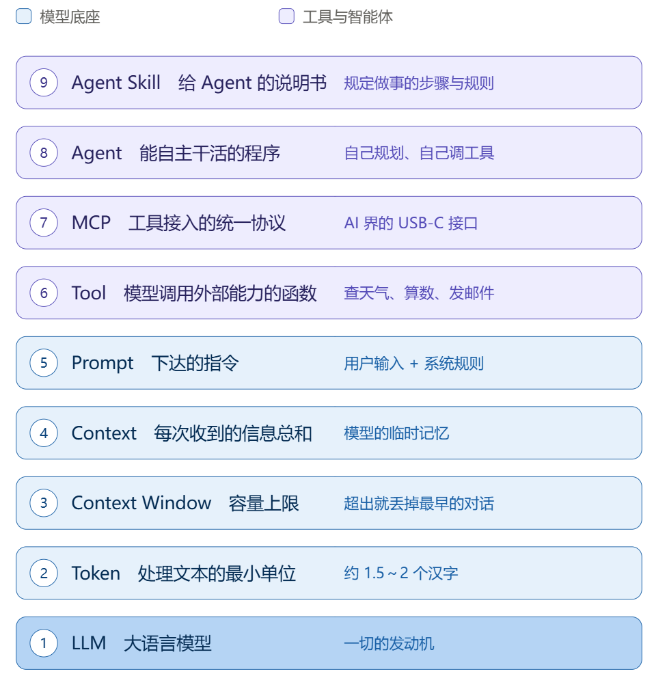

## 1. LLM（大语言模型）——一切的发动机

几乎所有现代大模型都基于 Google 2017 年提出的 Transformer 架构；2022 年底 GPT-3.5 让它真正可用，2023 年 GPT-4 拉高上限，现在 GPT / Claude / Gemini 同台竞争。

它的工作方式非常朴素：**文字接龙**。一次预测下一个概率最高的词，把新词拼回输入再预测下一个，直到输出"结束符"。这就是为什么 AI 的回答是一个字一个字往外蹦——不是装酷，底层就是这样。

## 2. Token —— 模型处理文本的最小单位

模型内部全是数学运算，只认数字不认字，所以需要"分词器"把文字切成 Token 并编号成 Token ID。

Token ≠ 词：中文里"程序员"会切成 2 个 Token，"工作坊"也是 2 个。粗略估算 **1 Token ≈ 1.5~2 个汉字，或 0.75 个英文单词**。做 AI 应用要算 Token 账，不是字数账。

## 3. Context —— 临时记忆

模型本身没有记忆，它只是一个"输入 → 输出"的函数。之所以能记得你前面说的话，是因为每次发消息时，**程序会把整段历史对话一起重新发给它**。对话越长，每次发送的数据越多、费用越高。

## 4. Context Window —— 容量的上限

上下文窗口就是这次能装多少 Token。超了怎么办？**最早的对话被丢掉**。所以"我开头说过我是做财务的，它后来怎么又问了一遍"——不是它笨，是最早那段被挤出窗口了。

现在主流模型的窗口在 128K ~ 1M Token 量级。

## 5. Prompt —— 指令，分两类

- **User Prompt**：你在对话框里打的字。
- **System Prompt**：开发者预先写好的"人设和规矩"（比如"你是银行客服，语气礼貌，不得透露内部信息"），每次请求都会偷偷放进上下文中，所以它能一直生效。

## 6. Tool —— 模型的"手"

模型有三块短板：不会精确算数、不知道实时信息、不能真的执行动作。

Tool 让它可以调用外部函数：查天气、搜网页、发邮件、改文件。模型不需要自己会做，只需要决定"**调哪个工具、传什么参数**"，拿到返回值再接着推理。

## 7. MCP —— 工具接入的统一标准

以前每个模型厂商的工具接入格式都不一样，接 GPT 写一套、接 Claude 再写一套。MCP 相当于**统一了插座规格**：工具开发者做一次，所有模型通用——可以理解为 AI 界的 USB-C。

## 8. Agent —— 能自己干活的程序

普通聊天是"你问一句它答一句"；Agent 会自己拆解任务、自己决定什么时候用什么工具、遇到阻碍就调整方案，一直干到问题解决。

像实习生接了"组织周五团建"这个活：自己查场地、查天气、改方案、下订单；而普通大模型像自动售货机——投币出货，一步不多做。

## 9. Agent Skill —— 给 Agent 的说明书

一份 Markdown 文档，规定"这个具体活儿该怎么干"。分两层：

- **元数据**（名称和描述，用来让 Agent 认路）
- **指令**（目标、步骤、判断规则、输出格式、示例）

Agent 平时只读元数据，只有任务相关时才加载正文——这种**"渐进式披露"**能省大量 Token。

## 串起来的一句话

> 一台装着 Token 燃料的 LLM 发动机，在 Context Window 限定的临时记忆里按 Prompt 干活，遇到自己不会的就通过 MCP 标准调用 Tool，当它升级成能自主规划的 Agent 之后，再用 Agent Skill 手册规范它干活的方式。
