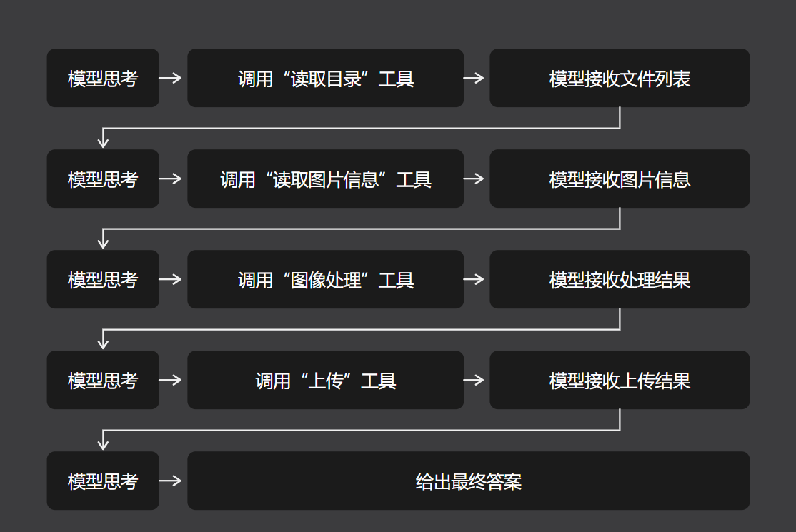
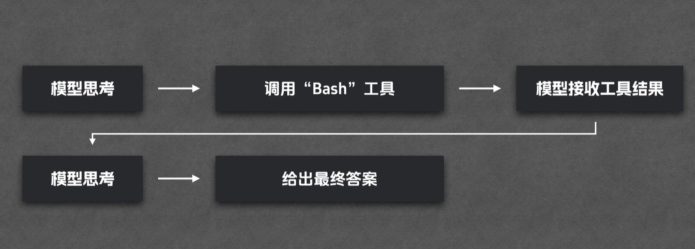
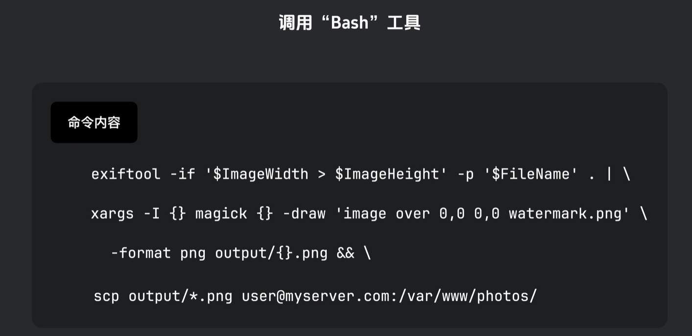
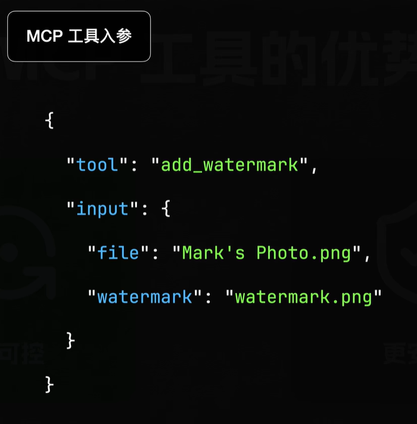

## 一、CLI 工具

| 工具     | 用途      |
| -------- | --------- |
| ffmpeg   | 转视频格式 |
| grep     | 搜文件     |
| magick   | 调图片尺寸 |

这类在命令行界面（Command Line Interface）执行的工具，统称 **CLI 工具**。

## 二、CLI 工具的优势

### 优势 1：Token 消耗小

（相反面：MCP 消耗 Token 大，这主要在于**元信息**——每个工具的名称、描述、入参格式都要塞进模型上下文，这意味就要消耗较多的 Token。）

**实测案例（GitHub MCP Server）**

| 指标                             | 数值                  |
| -------------------------------- | --------------------- |
| 单个工具 list_issues 说明        | 67 行                 |
| 该 MCP Server 工具总数           | 44 个                 |
| 全部工具说明总行数               | 1,683 行              |
| 字符数                           | 63,703                |
| 折算 token                       | **约 14,268 tokens**  |
| 单次调用成本（Claude Sonnet 计价） | **约 0.3 元**         |

> 注：单单一个 3 毛钱似乎无所谓，但同时装了很多 MCP，一个简单的工具说明就能花掉几块钱。

### 优势 2：执行效率高

**场景**：摄影师有 10 张单反照片，要挑出横版（宽 > 高）→ 加水印 → 上传服务器。

**MCP 模式**：模型是调度中心，每步都要回传，如下图。

**共 5 轮模型往返**，每步结果都必须先回到模型「看过」才能继续，效率卡在这里。

**CLI 模式**：一次生成，本地跑完。

调用 Bash 工具命令如下：

## 三、MCP 的两大不可替代优势

### 优势 1：更可控

**CLI 的隐患**：调用 Bash 工具命令看着没问题，实则暗含风险。

1. 若某张横版照片文件名含**单引号**（如 mark's photo.png），引号结构被破坏，命令**直接报错**。
2. 命令越复杂，出错概率越高；且这类错误**很隐蔽**，人类审查时很难一眼看出。

**MCP 的做法**：文件名老老实实躺在 JSON 的一个字段里，含单引号、双引号、空格都不影响执行。JSON 有自己的转义规则，**参数边界清晰**，不会和命令语法冲突 → 执行结果更可控，出错概率更低。

### 优势 2：更安全

- CLI 的灵活性是**双刃剑**：什么都能做，也就意味着**什么都能搞砸**。
- 命令里若夹带 `rm -rf` 之类的操作，本地文件可能被误删。模型可能只是「好心」想删临时文件，但一旦犯错，往往**执行完才后知后觉**。
- 本地环境尚可自担后果，**云端就是另一回事**：
  - 例如 make.com 这类云自动化服务，允许工作流接入 MCP 服务，但**绝不会让你直接执行 bash 命令**——共享环境下，一条失控命令可能搞崩整台服务器甚至整个集群。
  - 现在虽也有云端产品支持 CLI，但都做了严格限制，本质是**靠沙箱 + 权限控制把风险锁住**，成本很高，安全性也难达到 MCP 的等级。

## 四、可直接带走的判断

- **选型口诀**：本地跑、要灵活、自己承担风险 → CLI；共享环境、要审计、要权限边界 → MCP。
- **给 Agent 加能力时的成本意识**：每接一个 MCP Server，都在给每次对话预扣一笔「元信息税」；接 3 个以上就要认真算账。
- **自研 CLI 的门槛没想象中高**：写个命令行工具 + 一份说明文档（Agent Skill）就能被模型用好，不必非得包成 MCP Server。
- **CLI 的致命弱点是引号和转义**：文件名/参数含特殊字符时的命令注入与语法破坏，是这类方案最常见的翻车点，做工程化必须做校验或沙箱。
- **组合优于封装**：与其开发一个大而全的工具，不如提供小而专、可串联的工具——需求变化时成本差几个数量级。
