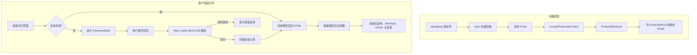

# 密码保护文章

恭喜！你已成功解锁这篇加密文章。浏览器使用 **Web Crypto API（AES-256-GCM + PBKDF2）** 在本地解密了这段预编译内容。

---

## 1. 安全架构与核心特性

Shirone 的文章加密系统与受保护相册共享统一的安全基础，为静态发布提供企业级安全性：

1. **静态 HTML 构建中不含明文**  
   在 Astro SSG 构建流程中，文章 Markdown 会被编译为 HTML，并在输出页面之前立即使用 AES-256-GCM 加密。发布的静态 HTML 中，受保护正文或大纲**不含任何明文**。

2. **带 AAD 作用域绑定的认证加密**  
   - 密钥派生遵循 OWASP 建议，采用 **310,000 次 PBKDF2 迭代**（SHA-256）以及密码学随机生成的 16 字节盐值；
   - 每个加密载荷都会生成独立的 12 字节随机 IV；
   - 通过 **附加认证数据（AAD）** 绑定 `shirone-protected-content:1:post:${slug}`，确保密文无法在不同文章或相册之间重放。

3. **会话持久化与磁盘零密码存储**  
   - 解密内容缓存在临时的浏览器会话存储中，30 分钟后过期；
   - 明文密码绝不会写入磁盘或存储；
   - 解密状态可在同一会话内的 Swup 客户端导航和页面刷新之间无缝保持。

4. **全站防泄漏**  
   - **搜索索引**：静态页面不含明文，可防止搜索引擎和 Pagefind 索引私密内容；
   - **RSS 订阅**：受保护文章在订阅源中输出本地化占位内容，防止 RSS 聚合器抓取敏感文本；
   - **卡片摘要与字数**：配置 `hideHomeContent: true` 时，索引页与归档卡片上的描述和字数会被遮蔽；
   - **目录（TOC）**：标题层级在解锁前保持隐藏，解密后按 M3E 样式动态重建并同步。

> 💡 **演示说明**：这篇演示文章的默认解锁密码是 `shirone-secret`。

---

## 2. 交互式富内容演示

文章解密后会与运行时辅助逻辑协同工作，动态挂载语法高亮、代码折叠、可交互 Mermaid 图表、LaTeX 公式和图片灯箱。

### 2.1 代码块与语法高亮

下面的代码块用于测试 Expressive Code 的语法高亮、复制操作和行装饰：

```typescript
import { decryptProtectedContent, type ProtectedPayload } from "@/utils/password-protection";

/**
 * 客户端文章解密示例
 */
async function unlockArticle(payload: ProtectedPayload, password: string): Promise<string> {
    const scope = payload.scope;
    console.log(`[Shirone] Decrypting scope: ${scope}`);
    
    // 执行带 AAD 校验的 AES-256-GCM 解密
    const decryptedHtml = await decryptProtectedContent(payload, password, scope);
    console.log("[Shirone] Decryption successful, length:", decryptedHtml.length);
    return decryptedHtml;
}
```

```bash
# 校验构建与类型检查
npx.cmd astro check
pnpm.cmd type-check
pnpm.cmd test
```

### 2.2 Mermaid 架构图

下面的流程图由 Mermaid 渲染，并在解密时动态绑定：



### 2.3 LaTeX 数学公式

行内公式：欧拉恒等式 $e^{i\pi} + 1 = 0$ 与高斯积分 $\int_{-\infty}^{\infty} e^{-x^2} dx = \sqrt{\pi}$。

使用带横向滚动容器的块级数学公式：

$$
f(x) = \frac{1}{\sigma \sqrt{2\pi}} \exp\left( -\frac{(x - \mu)^2}{2\sigma^2} \right)
$$

$$
\mathcal{L}_{\text{AES-GCM}} = \text{GHASH}_H(A \parallel C \parallel L) \oplus \text{AES}_K(J_0)
$$

### 2.4 提示容器

:::note 架构说明
这套加密系统遵循原子化设计原则与最小补丁约定，且不牺牲 SSR 稳定性。
:::

:::tip 主题集成
解锁后，可以尝试在浅色与深色模式之间切换，或更改主色调；解密后的组件会动态适配当前生效的设计令牌。
:::

:::important 安全范围
静态客户端加密旨在防止未经授权的浏览和自动索引。对于关键商业机密，建议使用服务端认证。
:::

:::warning 密码恢复
静态加密没有集中式服务器数据库。如果忘记密码，加密内容将无法恢复。
:::

### 2.5 GitHub 仓库卡片

::github{repo="withastro/astro"}

---

## 3. 配置参考

| 参数 | 类型 | 必填 | 默认值 | 说明 |
| :--- | :--- | :--- | :--- | :--- |
| `encrypted` | `boolean` | 否 | `false` | 显式标记文章为加密状态。若设置了 `password`，则隐式为 `true`。 |
| `password` | `string` | 是 | 无 | 明文密码，用于构建时加密、运行时解锁。 |
| `passwordHint` | `string` | 否 | `""` | 显示在密码输入框下方的可选提示。 |
| `hideHomeContent` | `boolean` | 否 | `true` | 在索引卡片、归档页和 RSS 订阅中隐藏文章描述与字数统计。 |

---

## 4. 总结

本演示验证了 Shirone 中完整的加密生命周期：静态输出零明文、可靠的密码学校验、跨导航与页面刷新的会话持久化，以及运行时动态重建。
