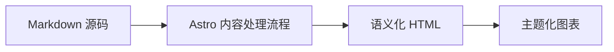

## GitHub 仓库卡片
你可以添加链接到 GitHub 仓库的动态卡片，页面加载时会从 GitHub API 拉取仓库信息。 

::github{repo="Fabrizz/MMM-OnSpotify"}

使用代码 `::github{repo="<owner>/<repo>"}` 创建 GitHub 仓库卡片。

```markdown
::github{repo="saicaca/fuwari"}
```

## Mermaid 图表

围栏 `mermaid` 代码块会渲染为图表，并跟随当前生效的配色方案。



## 提示容器

支持以下类型的提示容器：`note` `tip` `important` `warning` `caution`

:::note
强调用户即使快速浏览也应当留意的信息。
:::

:::tip
帮助用户更顺利完成任务的补充信息。
:::

:::important
用户成功所需的关键信息。
:::

:::warning
因存在潜在风险而需要用户立即关注的重要内容。
:::

:::caution
某项操作可能带来的负面后果。
:::

### 基础语法

```markdown
:::note
强调用户即使快速浏览也应当留意的信息。
:::

:::tip
帮助用户更顺利完成任务的补充信息。
:::
```

### 自定义标题

提示容器的标题可以自定义。

:::note[我的自定义标题]
这是一条带自定义标题的提示。
:::

```markdown
:::note[我的自定义标题]
这是一条带自定义标题的提示。
:::
```

### GitHub 语法

> [!TIP]
> 也支持 [GitHub 语法](https://github.com/orgs/community/discussions/16925)。

```
> [!NOTE]
> 也支持 GitHub 语法。

> [!TIP]
> 也支持 GitHub 语法。
```

### 剧透

你可以为文字添加剧透，这些文字同样支持 **Markdown** 语法。

内容 :spoiler[被隐藏了 **嘿嘿**]！

```markdown
内容 :spoiler[被隐藏了 **嘿嘿**]！

```

## 图片宽度与说明文字

独立图片可以在其替代文本中接受可选的 `w-N%` 宽度标记，并可用 Markdown 标题作为图片下方居中的说明文字：


```markdown

```

有效宽度范围为 `w-1%` 到 `w-100%`；无效标记会保留在替代文本中。宽度与说明文字相互独立——仅提供标题同样会生成说明文字：


