Mermaid 能把 Markdown 中的文字描述转换成图表。下面的示例沿用 Shirone 的内容工作流，展示技术文章与项目笔记中常见的几种图表类型。

## 流程图

流程图用于描述一个流程，包括判断分支以及返回前面步骤的路径。

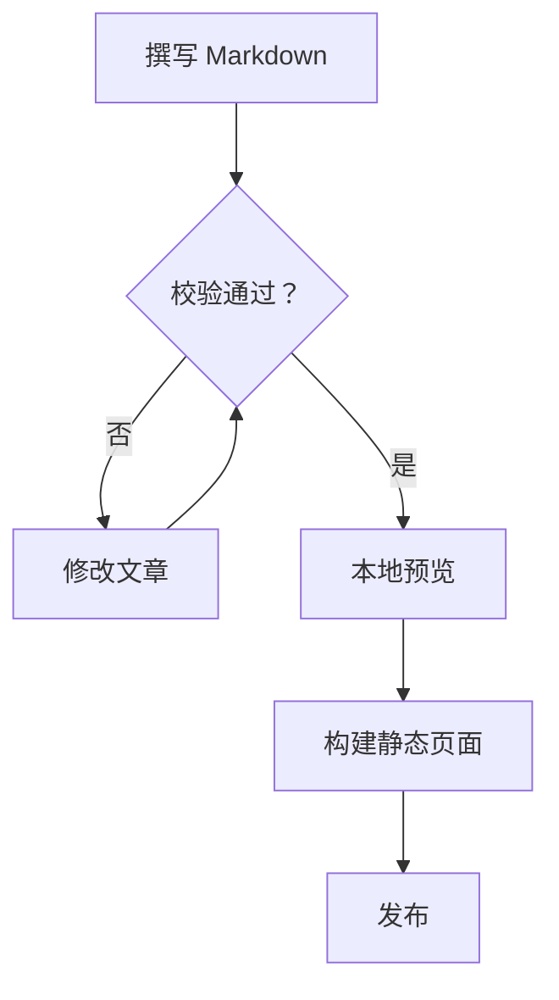

## 时序图

时序图按时间顺序展示各参与者之间的协作过程。本例展示一次 Swup 站内导航，从发起请求到 Mermaid 完成渲染。

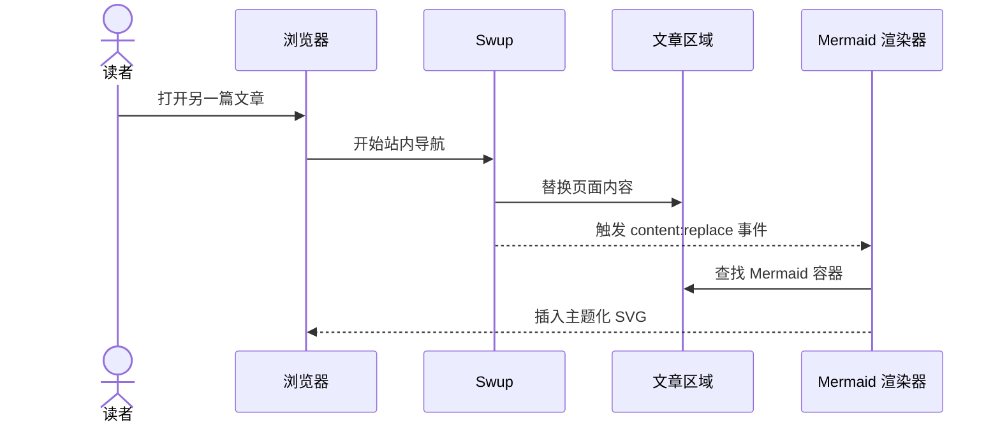

## 实体关系图

实体关系图为结构化数据建模，并展示作者、文章、标签与评论之间的关联。

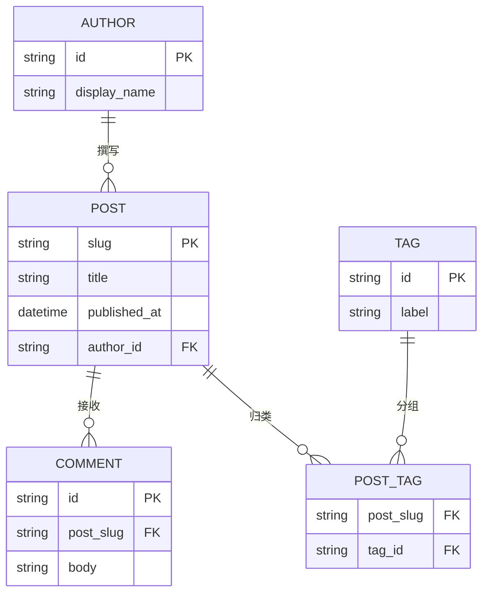

## 类图

类图表达软件设计中的职责划分、公开方法与依赖方向。

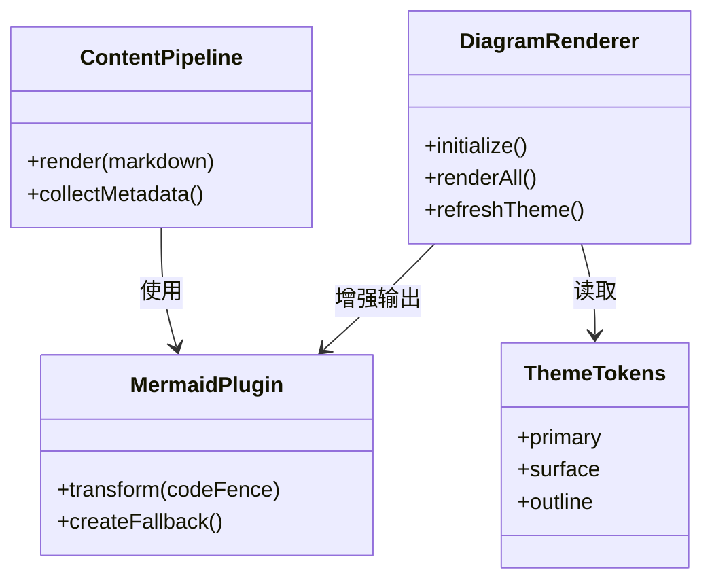

## 状态图

状态图展示一个对象的生命周期，以及推动它在各状态之间转移的事件。

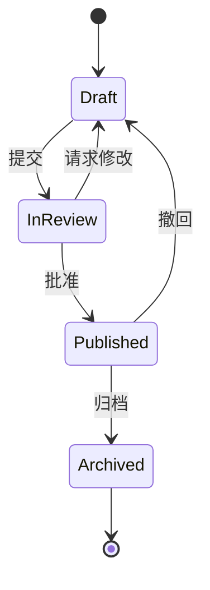

## XY 图表

XY 图表把柱形与折线组合在同一条坐标轴上，用于比较数值与趋势。

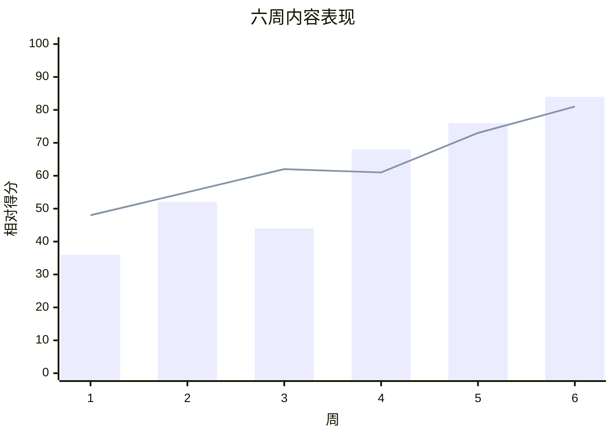

## 饼图

饼图以紧凑的方式比较各个类别在整体中所占的比例。

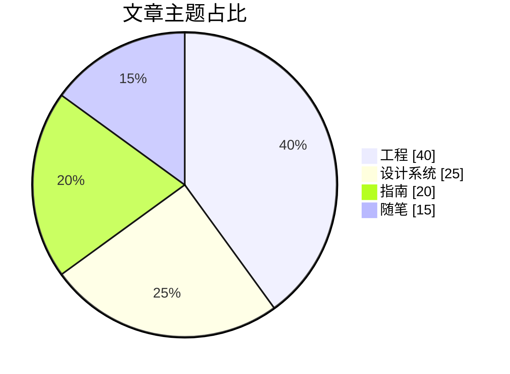

## 甘特图

甘特图把任务、依赖关系与里程碑排列在日历时间轴上。

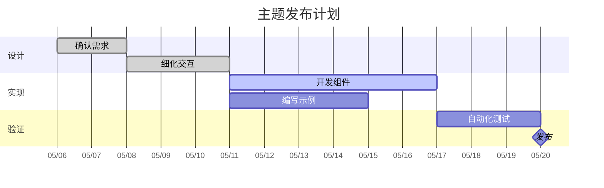

## 思维导图

思维导图把一个中心主题扩展为相关领域与支撑概念。

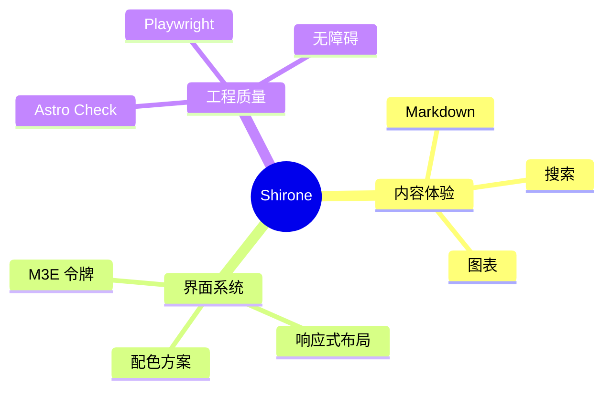

## 时间线

时间线概括重要事件或阶段，不需要精确的日历时长。

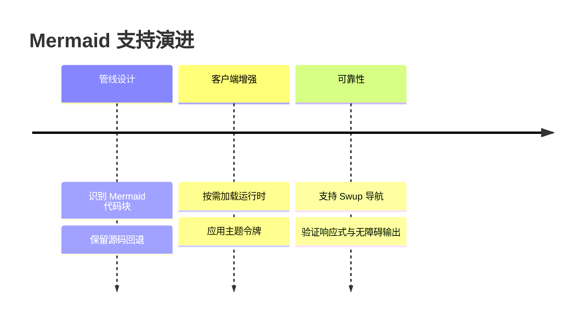

## 用户旅程图

用户旅程图把任务各阶段中的行为、参与者与体验评分综合呈现。

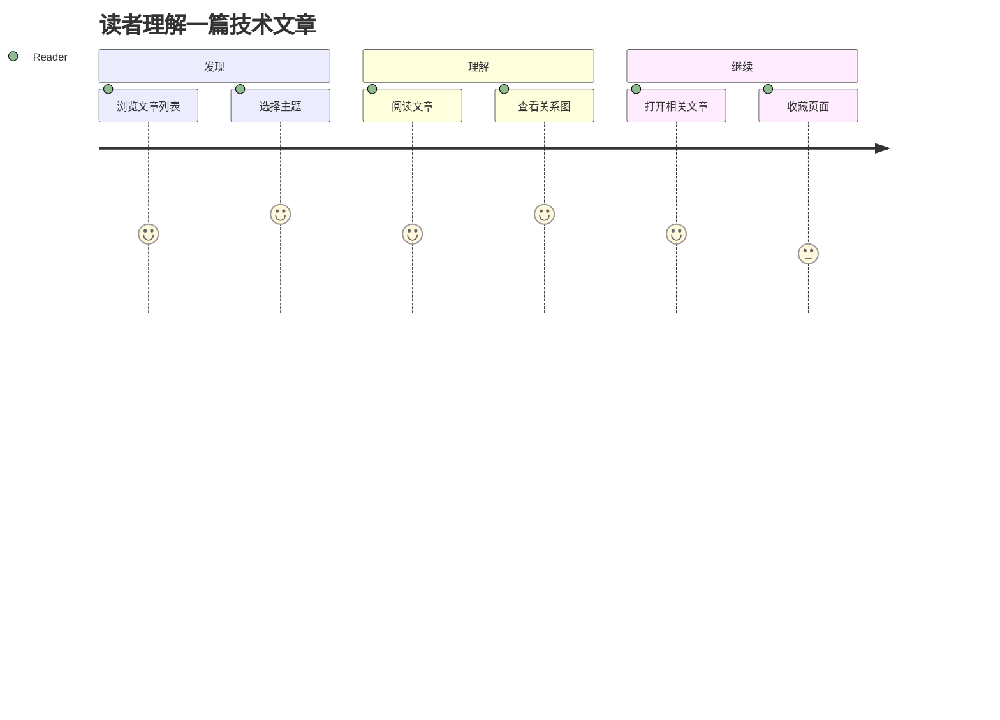

## Git 图

Git 图展示功能分支上的工作如何推进，直至合并到主线。

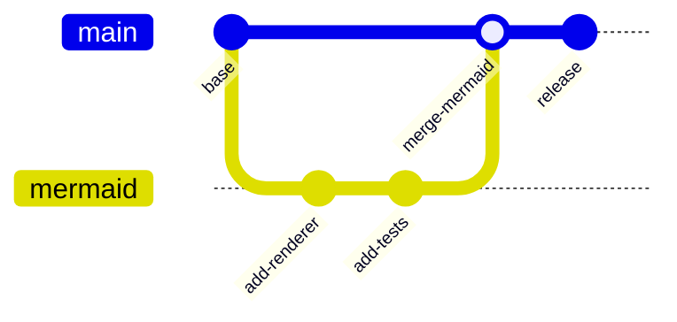

## 看板

看板按工作流状态给任务分组，让当前进展一目了然。

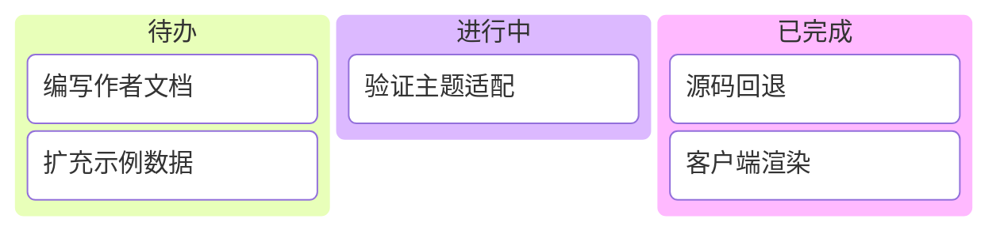

## 桑基图

桑基图用连线宽度表示流量或其他数量在节点之间的流向。

```mermaid
sankey-beta
落地页,阅读,720
发现,阅读,430
阅读,探索,360
阅读,主题,210
阅读,外链,140
```

## 标签中的换行

HTML 标签支持换行，因此标签内容可以折行显示而不会撑宽图表。

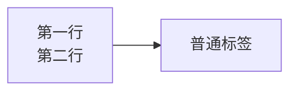

每个示例都使用标准的 `mermaid` 代码围栏。服务端会保留可读的源码标记，浏览器再把它增强为跟随当前主题的 SVG。当主题切换或 Swup 导航到本文时，图表会重新渲染。
